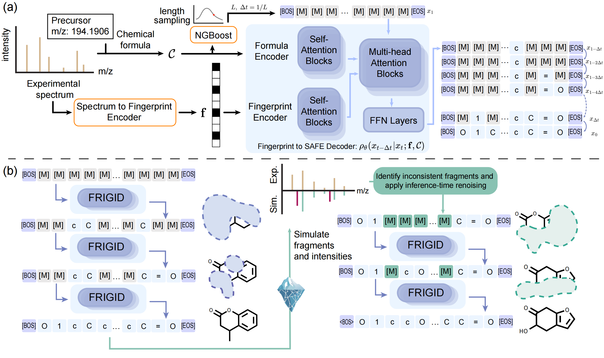
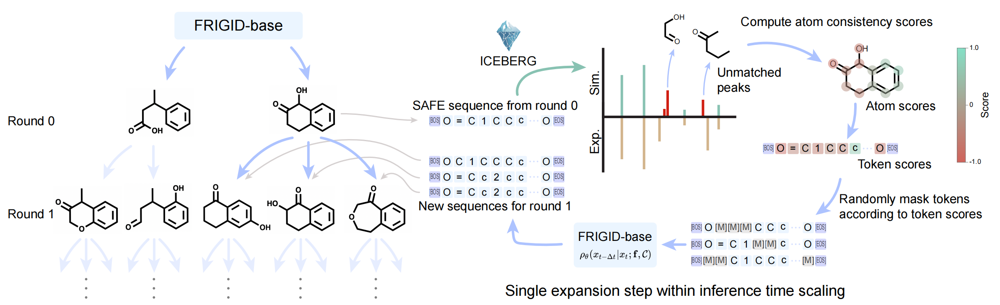
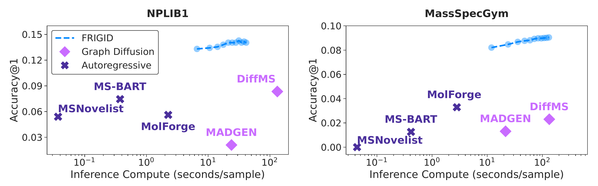

# FRIGID: Scaling Diffusion-Based Molecular Generation from Mass Spectra at Training and Inference Time

> [!IMPORTANT]
> **Updated MIST encoders and benchmark results.** In the previous release, MIST training for MassSpecGym used synthetic spectra of PubChem molecules selected to match or resemble the chemical formulae of test molecules. Although exact test structures were excluded, this selection still used test-set information.
>
> We have replaced the MIST encoders and repeated the FRIGID and MolForge evaluations using MIST 2M-aug on NPLIB1 and MIST 4M-aug on MassSpecGym. These encoders are trained on the respective experimental training splits, augmented with GLACIER spectra for 2 million sampled PubChem molecules and the official 4 million MassSpecGym molecules. The revised results supersede those previously reported; both are presented [below](#results). The checkpoints and complete training code are available in [coleygroup/MIST](https://github.com/coleygroup/MIST).

This is the codebase for our preprint [FRIGID: Scaling Diffusion-Based Molecular Generation from Mass Spectra at Training and Inference Time](https://arxiv.org/abs/2604.16648). **FRIGID** is a diffusion language model (DLM) framework for *de novo* structural elucidation from tandem mass spectra (MS/MS). Given an observed spectrum, FRIGID generates molecular structures as SAFE sequences conditioned on intermediate fingerprint representations and chemical formulae, with optional iterative refinement guided by a forward fragmentation model (ICEBERG).

<p align="center">
  
  <br>
  <em>FRIGID architecture and pipeline overview. (a) FRIGID-base: Spectrum → fingerprint (MIST) + formula → diffusion decoder. (b) ICEBERG-guided inference-time refinement.</em>
</p>

The FRIGID codebase is adapted from [GenMol](https://github.com/NVIDIA-Digital-Bio/genmol). 

---

## Overview

Tandem mass spectrometry (MS/MS) is central to small molecule identification in metabolomics, drug discovery, and environmental chemistry. While retrieval-based pipelines are limited to known chemical libraries, *de novo* elucidation models can propose novel structures directly from spectra.

FRIGID addresses two key limitations of prior work: poor scalability at training time and the absence of automatic correction mechanisms at inference time.

**Key contributions:**

1. **FRIGID-base**: A masked diffusion language model (MDLM) that generates SAFE molecular strings conditioned on predicted Morgan fingerprints (via MIST) and chemical formulae (via cross-attention). Trained on up to 230 million unlabeled structures, FRIGID-base achieves strong results through pretraining-scale improvements alone.

2. **ICEBERG-guided inference-time scaling**: A cycle-consistent refinement pipeline that uses ICEBERG (a forward fragmentation model) to simulate spectra of generated candidates, identify hallucinated fragments, and iteratively remask and re-denoise inconsistent substructures. Additional refinement rounds improve identification accuracy on both benchmarks.

3. **Benchmark performance**: With the revised MIST encoders and 10 rounds of refinement, FRIGID reaches 14.16% Top-1 accuracy on NPLIB1 and 9.05% on MassSpecGym, compared with 13.31% and 8.21% for FRIGID-base.

---

## How It Works

### Stage 1: FRIGID-base — Spectrum-Conditioned Diffusion Generation

FRIGID-base is a BERT-style MDLM that generates molecular SAFE sequences conditioned on two signals derived from the input spectrum:

- **Fingerprint conditioning**: MIST encoder predicts a 4096-bit radius-2 Morgan fingerprint from the spectrum. Active bit indices are embedded and processed through 3 self-attention layers, then injected via cross-attention into every Transformer block.
- **Formula conditioning**: The precursor chemical formula (inferred from MS1) is encoded as a per-element count embedding sequence, also injected via shared cross-attention.
- **Length prediction**: An NGBoost model predicts the distribution of SAFE token lengths for a given formula, enabling sampling of an appropriate sequence length before denoising.

### Stage 2: ICEBERG-Guided Inference-Time Scaling

After initial generation, FRIGID applies iterative spectrum-structure cycle-consistency refinement:

1. Generate a batch of candidate structures with FRIGID-base (Round 0).
2. Rank candidates by Tanimoto similarity to the predicted fingerprint and select top-M.
3. For each candidate, run ICEBERG to simulate its MS/MS spectrum.
4. Compare simulated peaks against the experimental spectrum; peaks present in simulation but absent in experiment are flagged as *hallucinations*.
5. Compute atom-wise consistency scores and aggregate to token-level masking probabilities.
6. Randomly remask inconsistent tokens and re-denoise with FRIGID-base to produce refined candidates.
7. Repeat for R rounds, accumulating a growing pool of unique candidates.

<p align="center">
  
  <br>
  <em>ICEBERG-guided inference-time scaling: atom consistency scores, token masking, and re-denoising of inconsistent substructures.</em>
</p>

---

## Results

Performance in the known chemical formula setting. FRIGID and our MolForge reimplementation use MIST 2M-aug on NPLIB1 and MIST 4M-aug on MassSpecGym. FRIGID-base denotes initial generation; FRIGID includes 10 rounds of ICEBERG-guided refinement.

<p align="center">
  
  <br>
  <em>Top-1 accuracy versus inference time on NPLIB1 (left) and MassSpecGym (right), using the revised MIST encoders. The blue dashed curves trace initial generation through 10 rounds of refinement.</em>
</p>

The tables report the revised results alongside the earlier manuscript values. Rows marked *previous* are retained for transparency and shown with strikethrough; they are superseded by the revised comparison. **Bold** indicates the best value among current results. † denotes our MolForge reimplementation.

### NPLIB1

| Model | Top-1 Acc ↑ | Top-1 MCES ↓ | Top-1 Tanimoto ↑ | Top-10 Acc ↑ | Top-10 MCES ↓ | Top-10 Tanimoto ↑ |
|---|---:|---:|---:|---:|---:|---:|
| Spec2Mol | 0.00% | 48.57 | 0.12 | 0.00% | 17.58 | 0.16 |
| MADGEN | 2.10% | 20.56 | 0.22 | 2.39% | 12.69 | 0.27 |
| MIST + Neuraldecipher | 2.32% | 10.26 | 0.35 | 6.11% | 8.53 | 0.43 |
| MIST + MolForge† | 5.62% | 20.72 | 0.43 | 11.36% | 10.55 | 0.52 |
| MIST + MSNovelist | 5.40% | 13.10 | 0.34 | 11.04% | 8.57 | 0.44 |
| MS-BART | 7.45% | 9.66 | 0.44 | 10.99% | 8.31 | 0.51 |
| DiffMS | 8.34% | 10.46 | 0.35 | 15.44% | 8.54 | 0.47 |
| **FRIGID-base** | 13.31% | 7.58 | 0.50 | 20.15% | 6.16 | 0.56 |
| *FRIGID-base (previous)* | ~~19.80%~~ | ~~7.88~~ | ~~0.54~~ | ~~24.41%~~ | ~~6.20~~ | ~~0.61~~ |
| **FRIGID** | **14.16%** | **7.16** | **0.51** | **25.27%** | **5.79** | **0.58** |
| *FRIGID (previous)* | ~~25.03%~~ | ~~7.10~~ | ~~0.58~~ | ~~33.37%~~ | ~~5.56~~ | ~~0.64~~ |

### MassSpecGym

| Model | Top-1 Acc ↑ | Top-1 MCES ↓ | Top-1 Tanimoto ↑ | Top-10 Acc ↑ | Top-10 MCES ↓ | Top-10 Tanimoto ↑ |
|---|---:|---:|---:|---:|---:|---:|
| MIST + MSNovelist | 0.00% | 39.84 | 0.06 | 0.00% | 18.83 | 0.15 |
| Spec2Mol | 0.00% | 36.78 | 0.12 | 0.00% | 36.02 | 0.16 |
| MIST + Neuraldecipher | 0.00% | 22.93 | 0.14 | 0.00% | 21.76 | 0.16 |
| MADGEN | 1.31% | 27.47 | 0.20 | 1.54% | 16.84 | 0.26 |
| MS-BART | 1.26% | 16.47 | 0.23 | 1.28% | 15.12 | 0.28 |
| DiffMS | 2.30% | 13.96 | 0.28 | 4.25% | 11.68 | 0.39 |
| FOAM (DiffMS + PubChem) | 1.50% | **12.21** | 0.35 | 10.28% | **6.06** | **0.53** |
| MIST + MolForge† | 3.29% | 31.77 | 0.31 | 5.65% | 16.67 | 0.40 |
| **FRIGID-base** | 8.21% | 13.16 | 0.38 | 9.82% | 11.65 | 0.43 |
| *FRIGID-base (previous)* | ~~16.09%~~ | ~~15.02~~ | ~~0.41~~ | ~~18.19%~~ | ~~11.95~~ | ~~0.46~~ |
| **FRIGID** | **9.05%** | 12.60 | **0.39** | **12.23%** | 11.41 | 0.43 |
| *FRIGID (previous)* | ~~18.29%~~ | ~~13.49~~ | ~~0.43~~ | ~~22.00%~~ | ~~11.65~~ | ~~0.47~~ |

MS-BART accuracies on MassSpecGym use 2D InChIKey matching. The previous MassSpecGym MolForge results used MIST vDiffMS at inference batch size 1. The paper's appendices, “MIST Encoders and MolForge Evaluation” and “MIST Training,” describe the encoder changes and report the FRIGID comparison between manuscript versions.

On NPLIB1, **FRIGID-base is 20× faster than DiffMS** (6.58 versus 131.2 seconds per spectrum on a single NVIDIA 6000 Ada GPU). FRIGID with 10 refinement rounds takes 41.3 seconds per spectrum.

---

## Repository Structure

```
frigid/
├── src/
│   ├── dlm/                            # FRIGID-base DLM and ICEBERG sampler
│   │   ├── model.py                    # DLM Lightning module (MDLM)
│   │   ├── sampler.py                  # Generation and sampling logic
│   │   ├── iceberg_sampler.py          # ICEBERG-guided inference-time scaling
│   │   ├── model_components.py         # Formula and fingerprint conditioners
│   │   ├── bert_with_cross_attention.py# Modified BERT backbone
│   │   ├── spec2mol_model.py           # Combined MIST+DLM pipeline
│   │   └── utils/
│   │       ├── utils_chem.py           # SAFE/SMILES chemistry utilities
│   │       ├── masking_utils.py        # Token masking for ICEBERG refinement
│   │       ├── benchmark_utils.py      # Evaluation metrics
│   │       └── formula_encoder.py      # Chemical formula encoding
│   └── mist/                           # MIST fingerprint encoder
│       ├── models/
│       │   ├── spectra_encoder.py      # MS/MS → fingerprint model
│       │   └── modules.py              # FormulaTransformer, attention blocks
│       └── data/
│
├── ms-pred/                            # ICEBERG forward model (git submodule)
│
├── scripts/
│   ├── train.py                        # FRIGID-base pretraining
│   ├── benchmark_spec2mol.py           # End-to-end benchmark (no scaling)
│   ├── spec2mol_scaling.py             # ICEBERG inference-time scaling
│   ├── compute_metrics.py              # Metric computation from saved results
│   ├── run_scaling_multi_gpu.py        # Multi-GPU scaling runner
│   └── multi_compute.py               # Multi-process compute utilities
│
├── configs/
│   ├── fp2mol_pretraining.yaml                # FRIGID-base pretraining config
│   ├── spec2mol_benchmark_canopus.yaml        # NPLIB1 benchmark config
│   └── spec2mol_benchmark_msg.yaml            # MassSpecGym benchmark config
│
├── token_models/                       # NGBoost length prediction models
│   ├── README.md                       # Training guide for token models
│   ├── train_opt_canopus.py            # Train on NPLIB1/CANOPUS data
│   ├── train_opt_msg.py                # Train on MassSpecGym data
│   ├── train_opt_canopus_pubchem.py    # Train with PubChem auxiliary data
│   ├── train_opt_msg_pubchem.py        # Train with PubChem auxiliary data
│   └── models/                         # Saved .joblib model files
│
├── data/
│   ├── canopus/                        # NPLIB1/CANOPUS dataset
│   ├── msg/                            # MassSpecGym dataset
│   └── exclude_inchikeys.csv           # Test/val InChIKeys excluded from training
│
├── checkpoints/                        # Separately downloaded MIST EMA checkpoints
├── frigid_pretrained_checkpoints/       # Extracted FRIGID release archive
│   ├── DLM.ckpt                        # FRIGID decoder
│   └── checkpoints/iceberg/             # CANOPUS and MSG ICEBERG weights
│
└── assets/                             # Paper figures
    ├── fig1_model_overview.png
    ├── fig2_iceberg_mechanism.png
    └── fig3_inference_scaling.png
```

---

## Installation

```bash
# Clone the repository (with ICEBERG submodule)
git clone --recurse-submodules <repo-url>
cd frigid

# If you cloned without --recurse-submodules
git submodule update --init --recursive

# Create conda environment
conda create -n frigid python=3.10
conda activate frigid

# Apply ms-pred compatibility patches (pin: e446eeb)
bash env/patch_ms_pred.sh

# Install a PyTorch build compatible with your CUDA/DGL environment first.
# Then install the remaining dependencies.
pip install -r ms-pred/requirements.txt
pip install -e ./ms-pred
pip install -e .

# (Optional) Install optuna for training NGBoost token models
pip install optuna
```

Local patches applied by `env/patch_ms_pred.sh`:

- `env/patches/ms-pred-e446eeb-instrument-profile.patch`: set `ICEBERG_INSTRUMENT_PROFILE=msg` or `canopus` to match the ICEBERG checkpoint.
- `env/patches/ms-pred-e446eeb-canopus-inference.patch`: accept CANOPUS MS/MS headers without collision energies, skip MS1 sections, fix best-energy selection, and launch ICEBERG as a Python module so inference works from the FRIGID root directory.
- `env/patches/ms-pred-e446eeb-requirements.patch`: remove the `setuptools==59.5.0` runtime pin so installing ms-pred requirements does not downgrade the build tooling below FRIGID's `setuptools>=64` requirement.

The script can be run again to apply missing patches. Use `--check` to check applicability without changing files, or `--reverse` to remove the patches.

---

## Data and checkpoint setup

Run the following commands from the repository root. CANOPUS data comes from the original MIST data record; MassSpecGym data comes from the DiffMS v3 record. Both retain the directory layout expected by the benchmark and token-model scripts.

```bash
bash data_processing/01_download_canopus_data.sh
bash data_processing/02_download_msg_data.sh

wget https://zenodo.org/records/23543494/files/frigid_pretrained_checkpoints.tar.gz
tar -xzf frigid_pretrained_checkpoints.tar.gz

mkdir -p checkpoints
wget -O checkpoints/mist_canopus_aug.ckpt https://zenodo.org/records/23303289/files/mist_canopus_aug.ckpt
wget -O checkpoints/mist_msg_aug.ckpt https://zenodo.org/records/23303289/files/mist_msg_aug.ckpt
```

The FRIGID archive contains `frigid_pretrained_checkpoints/DLM.ckpt` and four ICEBERG checkpoints under `frigid_pretrained_checkpoints/checkpoints/iceberg/`. Use `iceberg_canopus_model1.ckpt` / `iceberg_canopus_model2.ckpt` for CANOPUS and `iceberg_msg_model1.ckpt` / `iceberg_msg_model2.ckpt` for MassSpecGym (generator / intensity model, respectively). MIST encoders are downloaded separately from the coleygroup/MIST release.

The FRIGID archive does not contain benchmark datasets, SAFE pretraining data, or NGBoost token-length models. The dataset scripts above prepare the benchmark data; SAFE pretraining uses `datamol-io/safe-gpt` on Hugging Face, and token-length models are trained as described below. Pass a trained length model with `--token-model token_models/models/<model>.joblib` when running benchmarks or scaling.

## Usage

### 1. Pretraining FRIGID-base

Train the MDLM backbone on a large corpus of unlabeled SAFE sequences. The training config specifies dataset paths, model architecture, and optimization settings:

```bash
python scripts/train.py --config configs/fp2mol_pretraining.yaml
```

Key configuration options in `configs/fp2mol_pretraining.yaml`:
- `data.hf_cache_dir`: path to the SAFE dataset (HuggingFace cache)
- `data.exclude_inchikeys_file`: path to `data/exclude_inchikeys.csv` to mask test structures
- `trainer.max_steps`: total optimization steps (default: 500,000)
- `loader.global_batch_size`: global batch size (default: 2048; scales across GPUs)
- `model.hidden_size` / `model.num_hidden_layers`: BERT backbone dimensions
- `training.ema`: EMA decay for parameter averaging (default: 0.9999)

### 2. Training NGBoost Token Length Models

FRIGID-base requires an NGBoost model to predict SAFE sequence lengths from molecular formulae. See `token_models/README.md` for full details.

```bash
cd token_models/
mkdir -p data

# Option A: train directly on benchmark data (fast)
python train_opt_canopus.py   # for NPLIB1
python train_opt_msg.py       # for MassSpecGym

# Option B: train with PubChem auxiliary data (recommended)
bash download_pubchem.sh
python generate_training_data.py
python train_opt_canopus_pubchem.py
python train_opt_msg_pubchem.py
cd ..
```

Trained models are saved to `token_models/models/`.

### 3. Running the Benchmark (without Inference-Time Scaling)

Evaluate FRIGID-base end-to-end on NPLIB1 or MassSpecGym:

```bash
# NPLIB1 / CANOPUS benchmark
python scripts/benchmark_spec2mol.py \
    --config configs/spec2mol_benchmark_canopus.yaml \
    --mist-checkpoint checkpoints/mist_canopus_aug.ckpt \
    --dlm-checkpoint frigid_pretrained_checkpoints/DLM.ckpt

# MassSpecGym benchmark
python scripts/benchmark_spec2mol.py \
    --config configs/spec2mol_benchmark_msg.yaml \
    --mist-checkpoint checkpoints/mist_msg_aug.ckpt \
    --dlm-checkpoint frigid_pretrained_checkpoints/DLM.ckpt
```

### 4. ICEBERG Inference-Time Scaling

Run the full FRIGID pipeline with cycle-consistent refinement over multiple rounds:

```bash
python scripts/spec2mol_scaling.py \
    --config configs/spec2mol_benchmark_canopus.yaml \
    --mist-checkpoint checkpoints/mist_canopus_aug.ckpt \
    --dlm-checkpoint frigid_pretrained_checkpoints/DLM.ckpt \
    --iceberg-gen-ckpt frigid_pretrained_checkpoints/checkpoints/iceberg/iceberg_canopus_model1.ckpt \
    --iceberg-inten-ckpt frigid_pretrained_checkpoints/checkpoints/iceberg/iceberg_canopus_model2.ckpt \
    --num-rounds 11 \
    --batch-size 128
```

Key scaling parameters:
- `--num-rounds`: total generation rounds, including initial generation; use 11 for the 10 refinement rounds reported above
- `--batch-size`: candidates generated per round B (default: 128)
- The script also accepts `--top-k` (top-M candidates selected per round) and `--num-renoised` (N masked variants per candidate)

For CANOPUS `.ms` files, `>ms2peaks` denotes an unknown collision energy, while `>ms1merged` and `>ms1peaks` sections are excluded from MS/MS comparisons. For each candidate, an experimental spectrum with unknown energy is matched to the ICEBERG prediction with the highest spectral similarity before refinement. Known energies use an exact match when available, otherwise the nearest predicted energy.

---

## Model Architecture Details

### FRIGID-base MDLM

The model evaluated in the paper uses a 12-layer BERT Transformer (hidden size 896, 14 heads, FFN dimension 3072) with cross-attention sublayers in each block:

| Component | Details |
|---|---|
| Backbone | BERT, 12 layers, d=896, H=14 |
| Total parameters | 247.0M |
| Vocabulary | BPE-tokenized SAFE, \|V\|=1880 |
| Max token length | 256 |
| Formula encoder | Per-element count embedding (30 elements) |
| Fingerprint encoder | Active-bit set encoder, 3-layer self-attention |
| Cross-attention | Shared pathway for formula + fingerprint |
| Noise schedule | Log-linear MDLM, continuous time |

### MIST Encoder

A FormulaTransformer-based encoder that maps MS/MS peak-formula pairs to 4096-bit Morgan fingerprint probabilities.

### ICEBERG Forward Model

A two-stage model (fragment generator + intensity predictor) trained on bond-breaking fragment enumeration via MAGMa. Separate ICEBERG models are trained on the training split of each benchmark to avoid leakage. At inference, spectra are simulated at collision energies {10–90 eV} and matched against experimental peaks within 20 ppm.

## Pretrained Checkpoints

Pretrained FRIGID decoders and ICEBERG models are available [here](https://zenodo.org/records/23543494). MIST encoder checkpoints are available [here](https://zenodo.org/records/23303289), with the complete training code in [coleygroup/MIST](https://github.com/coleygroup/MIST). The MIST checkpoints, `mist_{canopus,msg}_{noaug,aug}.ckpt`, cover CANOPUS and MassSpecGym, with (`aug`) or without (`noaug`) synthetic training spectra.

Specify the MIST checkpoint for the chosen dataset using `--mist-checkpoint`, as shown in the benchmark examples above.

## License

FRIGID is released under the [Apache 2.0](LICENSE/license_code.txt) license.

## Contact

If you have any questions, please reach out to mbohde@tamu.edu or liuhx25@mit.edu.

---

## Citation

If you find this codebase useful in your research, please kindly cite the following manuscript:
```bibtex
@misc{frigid2026,
      title={FRIGID: Scaling Diffusion-Based Molecular Generation from Mass Spectra at Training and Inference Time}, 
      author={Montgomery Bohde and Hongxuan Liu and Mrunali Manjrekar and Magdalena Lederbauer and Shuiwang Ji and Runzhong Wang and Connor W. Coley},
      year={2026},
      eprint={2604.16648},
      archivePrefix={arXiv},
      primaryClass={cs.LG},
      url={https://arxiv.org/abs/2604.16648}, 
}
```

---

## Acknowledgements

FRIGID builds on [GenMol](https://arxiv.org/abs/2501.06158) (NVIDIA), [MIST](https://www.nature.com/articles/s42256-023-00708-3), [ICEBERG](https://www.biorxiv.org/content/10.1101/2025.01.09.631755), and the [SAFE](https://arxiv.org/abs/2310.10773) molecular representation. Datasets: [NPLIB1](https://doi.org/10.1038/s41587-020-0740-8), [MassSpecGym](https://arxiv.org/abs/2410.23326).
